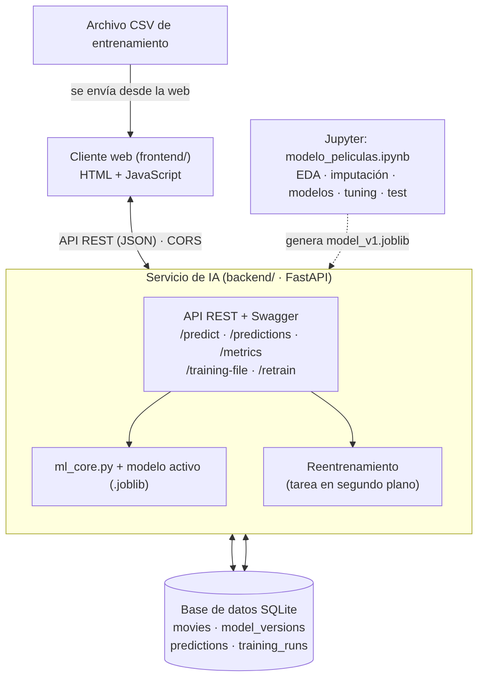

# Movie Score — predicción del score de películas (CRISP-ML(Q))

Servicio de IA con API REST (FastAPI + Swagger), base de datos y aplicación web para **estimar el score de una película antes de producirla**.
Incluye subida de archivos de entrenamiento y **reentrenamiento** del modelo.



## Estructura
```
notebooks/modelo_peliculas.ipynb   modelo completo: EDA, imputación, pipeline, modelos, tuning, test, guardado
backend/                           servicio de IA (FastAPI)
  app/                             API, base de datos, predicción, reentrenamiento
  ml_core.py                       código de ML compartido con el notebook
  models/                          modelo entrenado (model_v1.joblib) y sus metadatos
  db/schema.sql                    script de la base de datos (se ejecuta al iniciar)
  tests/                           pruebas
frontend/                          cliente web (HTML + CSS + JavaScript, sin dependencias)
data/movies.csv                    datos originales
data/demo_nuevas_peliculas_2017_2020.csv   archivo de ejemplo para probar la subida y el reentrenamiento
docs/                              cronograma, documento CRISP-ML(Q), Model Card, diagrama de BD, openapi.json, guion de video
```

## Puesta en marcha
**1. Servicio de IA** (Python 3.10 o superior)
```bash
cd backend
python -m venv .venv
source .venv/bin/activate            # Windows: .venv\Scripts\activate
pip install -r requirements.txt
uvicorn app.main:app --reload --port 8000
```
Documentación interactiva (Swagger): <http://localhost:8000/docs> · contrato: <http://localhost:8000/openapi.json>.
La primera vez se crea la base de datos (`backend/data/app.db`), se registra el modelo `v1` y se cargan las 7.043 películas de entrenamiento.
Para empezar de cero, detén el servicio y borra `backend/data/app.db`.

**2. Cliente web** (en otra terminal)
```bash
cd frontend
python -m http.server 5500
```
Abrir <http://localhost:5500>. Si el servicio está en otra dirección, «Configurar API» (arriba a la derecha).
Orígenes autorizados por CORS: variable de entorno `CORS_ORIGINS` (por defecto, `localhost:5500`, `8080` y `3000`).

**3. Notebook** (opcional: regenera el modelo)
```bash
pip install jupyter
cd notebooks && jupyter notebook modelo_peliculas.ipynb
```
Tarda unos 8 minutos (el tuning es lo más lento; baja `N_ITER` para una prueba rápida). Escribe el modelo en `backend/models/`.

## Endpoints
| Método y ruta | Para qué |
|---|---|
| `POST /predict` | Enviar datos y obtener la predicción |
| `GET /predictions` | Historial de predicciones (datos enviados y resultado) |
| `GET /metrics`, `GET /models` | Métricas del modelo activo y de todas sus versiones |
| `POST /training-file` | Enviar el archivo CSV de entrenamiento |
| `POST /retrain`, `GET /retrain/{id}`, `GET /retrain` | Solicitar el reentrenamiento y consultar su estado |
| `GET /health`, `GET /options`, `GET /dataset` | Estado del servicio y datos auxiliares |

Ejemplo:
```bash
curl -X POST localhost:8000/predict -H "Content-Type: application/json" \
  -d '{"genre":"Drama","year":2022,"director":"Christopher Nolan","budget":100000000,"runtime":150}'
```

## Pruebas
```bash
cd backend && pytest -q
```
Con FastAPI instalado se ejecutan también las pruebas HTTP de `tests/test_api.py`. Para regenerar el Swagger oficial: `python -m app.export_openapi` (escribe `docs/openapi.json`).

## Resultado del modelo (test ciego 2017–2020)
MAE **0,618** (baseline de la media: 0,732, mejora del 15,5 %) · RMSE 0,849 · R² 0,188. El R² no alcanza el umbral de 0,30 definido de antemano; el detalle y las limitaciones están en `docs/CRISP-ML-Q_y_desarrollo.md` y `docs/model_card.md`.

## Documentación
- `docs/cronograma.md` — cronograma CRISP-ML(Q)
- `docs/CRISP-ML-Q_y_desarrollo.md` — aplicación de la metodología y desarrollo del servicio y del cliente
- `docs/model_card.md` — ficha del modelo · `docs/data_dictionary.md` — diccionario de datos
- `docs/database/` — diagrama (`er_diagram.png`) y script SQL · `docs/openapi.json` — Swagger
- `docs/guion_video.md` — guion del video · `docs/guia_git_y_pr.md` — ramas y Pull Requests
