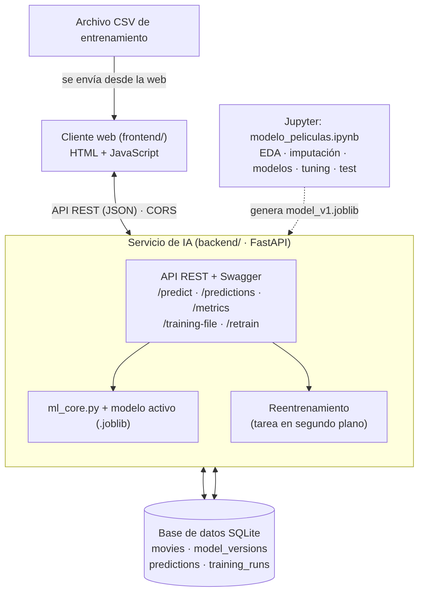
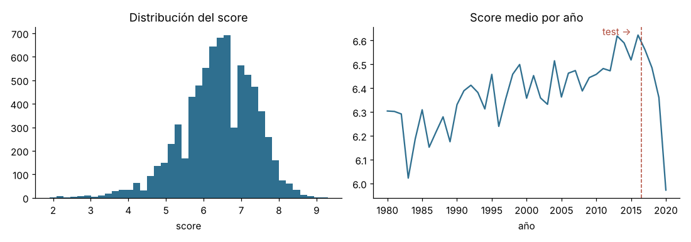
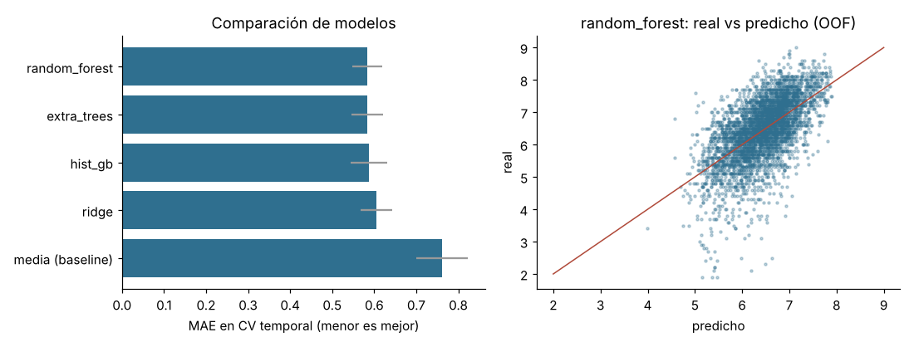
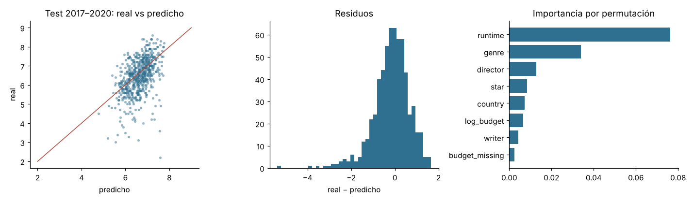
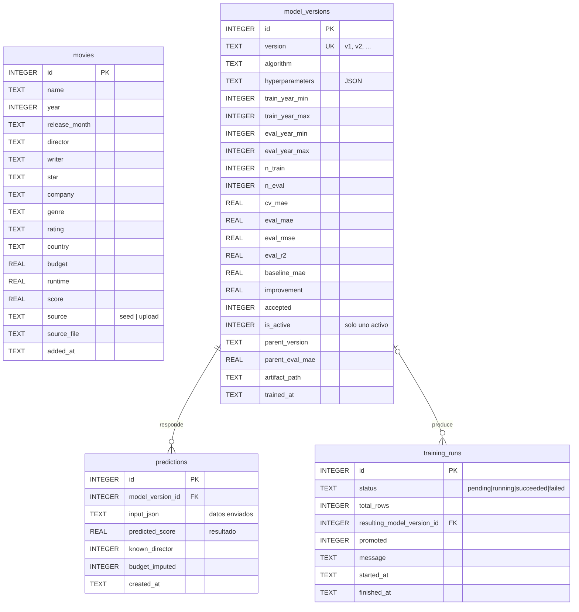

# Aplicación de CRISP-ML(Q) y desarrollo del servicio y del cliente web

**Proyecto:** predicción del score de películas con un servicio de IA (API REST), base de datos y aplicación web.

## 1. Resumen
Se entrenó un modelo de **regresión** que estima el `score` (0–10) de una película **antes de producirla**, usando solo datos
de pre-producción. El modelo se expone mediante una API REST (con Swagger) que permite predecir, consultar el historial de predicciones,
ver las métricas, subir un archivo de entrenamiento y **reentrenar**. Una aplicación web consume todos los endpoints.
El trabajo siguió la metodología **CRISP-ML(Q)**, que añade un control de calidad (QA) a cada fase.

| | Resultado en test ciego (2017–2020, 622 películas) |
|---|---|
| Modelo | Ensamble (promedio) de Random Forest + Extra Trees + HistGradientBoosting |
| MAE | **0,618** puntos (baseline de la media: 0,732) → mejora del **15,5 %** (IC 95 %: 11,2 %–19,9 %) |
| RMSE | 0,849 (baseline 0,945) |
| R² | **0,188** (baseline −0,005) |

El modelo cumple cuatro de los cinco criterios de aceptación definidos en la fase 1 (MAE ≤ 0,65; mejora ≥ 10 %; R² ≤ 0,80, es decir, sin señales de fuga de datos; y estabilidad entre folds) y **no
cumple R² ≥ 0,30**. El resultado se reporta tal cual, sin modificar el umbral (ver sección 2.4).

## 2. CRISP-ML(Q) fase por fase
El cronograma completo está en `docs/cronograma.md`.

### 2.1 Business & Data Understanding
- **Problema:** una empresa de contenidos quiere priorizar proyectos estimando la calidad percibida antes de producirlos.
- **Tarea:** regresión supervisada; objetivo `score`. Dataset `movies.csv`: 7.668 películas (1980–2020), 15 columnas.
- **Regla anti-fuga de datos:** `votes`, `gross`, la fecha exacta de estreno y `name` quedan excluidos porque se conocen después del estreno o no aportan.
  Se comprobó que añadir `votes` sube el R² de 0,19 a 0,43 con las mismas variables base: un modelo así no serviría en producción.
- **Métricas:** MAE (principal, en puntos de score), RMSE y R², siempre frente al baseline de predecir la media.
- **Criterios de aceptación:** MAE ≤ 0,65; mejora ≥ 10 % sobre el baseline; R² ≥ 0,30; R² ≤ 0,80 (si no, se sospecha fuga); desviación del MAE entre folds < 0,06.
- **Hallazgos del EDA** (`docs/crisp-ml/02_eda_report.md`): `budget` falta en el 28,3 % de las filas; `director`, `writer`, `star` y `company` tienen miles de valores
  y más de la mitad aparece una sola vez (one-hot inviable); el valor `Directors` es basura en 28 filas; desviación estándar del score 0,97 (MAE de la media: 0,76).
- **Riesgos:** fuga de datos, sobreajuste por alta cardinalidad, directores nuevos (cold start), cambio temporal y sesgo hacia nombres consolidados.

### 2.2 Data Engineering
- **Split temporal antes de imputar:** entrenamiento ≤ 2016 (7.043 películas) y **test ciego 2017–2020** (622). Simula usar el pasado para predecir el futuro.
- **Imputación de `budget`:** se compararon cuatro métodos enmascarando el 25 % de los presupuestos conocidos.

| Método | RMSE en log(budget) |
|---|---|
| Iterative (+género, país) | 1,098 |
| **Mediana por género y bloque de 5 años** | 1,193 |
| KNN (k=10) | 1,261 |
| Mediana global | 1,367 |

  En el efecto sobre el modelo las diferencias fueron de 0,005 de MAE frente a una desviación de 0,045 entre folds: **no significativas**. Se eligió la mediana por género y año por ser simple,
  determinista, explicable y fácil de reproducir en la API.
- **Alta cardinalidad:** en lugar de one-hot o *target encoding*, un `HistoryEncoder` calcula para cada película el número y el score medio de las películas **de años anteriores** del mismo director, guionista, estrella y productora
  (suavizado). Para entidades nuevas usa la media global.
- **Pipeline de scikit-learn:** imputación, historial y encodings se ajustan solo con los datos de entrenamiento de cada fold. Verificación automática: ninguna columna prohibida entra al modelo y no quedan nulos tras el pipeline.

### 2.3 ML Model Engineering
- **Validación:** CV temporal de 5 folds (*forward-chaining*): cada fold valida con años posteriores a los de su entrenamiento.
- **Comparación (CV, sin tuning):**

| Modelo | MAE | R² |
|---|---|---|
| Random Forest | 0,583 | 0,364 |
| Extra Trees | 0,584 | 0,363 |
| HistGradientBoosting | 0,588 | 0,357 |
| Ridge | 0,605 | 0,324 |
| Baseline (media) | 0,762 | −0,026 |

- **Tuning y ensamble:** búsqueda aleatoria (12 combinaciones por modelo). El ensamble de los tres mejores obtuvo el menor MAE en CV (0,575; R² 0,382) y se eligió **solo con CV**, sin mirar el test.
- **Reproducibilidad:** semilla 42, versiones de librerías y metadatos guardados junto al modelo (`backend/models/model_v1_metadata.json`) y Model Card (`docs/model_card.md`).

### 2.4 Evaluation & QA
- El test ciego se evaluó **una sola vez**: MAE 0,618 · RMSE 0,849 · R² 0,188; prueba de Wilcoxon pareada contra el baseline p ≈ 4·10⁻⁹.
- **R² por debajo del umbral:** el R² del test (0,188) no alcanza el 0,30 fijado de antemano, aunque el del CV fue 0,38. Por año el R² varía mucho (0,35 en 2018; 0,03 en 2019) con solo ~200 películas por año, por lo que es una estimación ruidosa; la brecha no se explica del todo con estos datos.
  Se decidió **no cambiar el umbral** y documentarlo.
- **Importancia por permutación:** `runtime` ≫ `genre` > `director` > `star` > `country` > `log_budget`.
- **Error por subgrupo:** mayor con directores sin historial (MAE 0,688 frente a 0,562) y fuera de EE.UU. (0,648 frente a 0,599). Por eso la API informa `known_director` y la web lo advierte.
- **Mayores errores:** fracasos extremos (score < 3,5) que el modelo sobrestima: con solo metadatos de pre-producción no hay señal para anticiparlos.

### 2.5 Deployment
El modelo se serializa con `joblib` (pipeline completo) junto con `ml_core.py`, el mismo código que usa el notebook. El servicio lo carga al arrancar y recarga el modelo activo si cambia de versión.

### 2.6 Monitoring & Maintenance
- **Reentrenamiento** (`POST /retrain`): entrena un candidato con todos los datos de la base, lo compara con el modelo activo sobre las **películas más recientes** (holdout) y solo lo **promueve** si lo mejora. Cada versión guarda sus métricas y la del modelo anterior sobre el mismo conjunto.
- **Pendiente (trabajo futuro):** monitoreo de *data drift* y *concept drift*, explicabilidad (SHAP), pruebas A/B y reentrenamiento programado.

## 3. Desarrollo del servicio de IA
**Tecnología:** Python, FastAPI (Swagger automático), SQLite (módulo estándar `sqlite3`), scikit-learn.

### 3.1 Endpoints (requisitos de la consigna)
| Requisito | Endpoint |
|---|---|
| Enviar datos y obtener la predicción | `POST /predict` |
| Historial de predicciones (datos enviados y resultado) | `GET /predictions` |
| Métricas de rendimiento | `GET /metrics`, `GET /models` |
| Solicitar el reentrenamiento | `POST /retrain`, `GET /retrain/{id}` (estado), `GET /retrain` |
| Enviar el archivo de entrenamiento | `POST /training-file` (CSV) |
| Auxiliares | `GET /health`, `GET /options`, `GET /dataset` |

El contrato completo está en `docs/openapi.json` y la documentación interactiva en `http://localhost:8000/docs`.

### 3.2 Decisiones de diseño
- **Validación de entradas** con pydantic: año 1900–2100, presupuesto > 0, duración 30–400, mes en inglés, español o número. Los campos extra (`votes`, `gross`) se ignoran.
- **Respuesta informativa:** además del score, `known_director`, `director_previous_films`, `budget_imputed` y avisos (director sin historial, presupuesto estimado, año fuera del rango de datos).
- **Subida de CSV** (`/training-file`): columnas obligatorias `year`, `score`, `genre`; el resto opcionales. Se rechazan filas inválidas, se omiten duplicados (mismo título y año) y se devuelve un informe. `votes` y `gross` se ignoran.
- **Reentrenamiento en segundo plano:** la petición responde `202` de inmediato con un identificador y el estado queda en la tabla `training_runs` (`pending`, `running`, `succeeded`, `failed`). No se permiten dos reentrenamientos simultáneos (`409`).
- **Regla de promoción:** el candidato se activa solo si su MAE es menor que el del modelo activo sobre el mismo holdout. Siempre hay un único modelo activo (índice único parcial en la base de datos).
- **CORS:** el navegador solo llama al backend; los orígenes permitidos se configuran con la variable `CORS_ORIGINS` (sin `*`).
- **Errores:** `404` (no existe), `409` (reentrenamiento en curso), `413` (archivo muy grande), `422` (datos inválidos), `503` (sin modelo activo).

### 3.3 Base de datos
Cuatro tablas (diagrama en `docs/database/er_diagram.png`, script en `docs/database/schema.sql`, que el servicio ejecuta al iniciar):
`movies` (datos de entrenamiento), `model_versions` (versiones y métricas), `predictions` (historial) y `training_runs` (reentrenamientos).

## 4. Cliente web
Aplicación en HTML, CSS y JavaScript (sin dependencias) en `frontend/`, que consulta **todos** los endpoints:
- **Predicción:** formulario con listas desplegables cargadas desde `/options`, resultado con el score, la versión del modelo y avisos.
- **Historial:** tabla paginada de predicciones.
- **Métricas:** indicadores del modelo activo frente al baseline, criterios de aceptación (con su estado real) y tabla de versiones.
- **Datos y reentrenamiento:** subida del CSV con informe, botón de reentrenar con seguimiento en vivo del estado y lista de reentrenamientos anteriores.
Diseño responsivo, modo claro/oscuro automático y mensajes de error claros (incluida la falta de conexión con el servicio).

## 5. Pruebas y verificación
- `backend/tests/test_core.py`: 12 pruebas de la lógica (carga inicial, predicción, validaciones, ausencia de variables prohibidas, subida y duplicados, reentrenamiento completo, concurrencia, fallos).
- `backend/tests/test_handlers.py`: manejadores de cada endpoint con los esquemas de respuesta.
- `backend/tests/test_api.py`: pruebas HTTP de la API real (FastAPI + TestClient), incluida la política de CORS.
- Pruebas del cliente en un navegador real: predicción, historial, métricas, subida (válida, repetida e inválida), reentrenamiento hasta la promoción y vista móvil.

Ejecución: `cd backend && pytest -q`.

## 6. Limitaciones y trabajo futuro
- R² de 0,19 en test: con solo metadatos de pre-producción la capacidad predictiva es limitada. Mejoras posibles: más historial de directores y reparto (por ejemplo, los datasets de IMDb), sinopsis y variables de título (secuelas), y un intervalo de confianza para el R².
- Menos fiable con directores sin historial y para años posteriores a 2020 (se advierte en la respuesta).
- Los reentrenamientos se comparan en un holdout reciente más pequeño (≈ 220 películas): diferencias de pocas centésimas no son significativas.
- Presupuestos en dólares nominales, sin ajuste por inflación; 28 % imputados.
- No hay autenticación en la API: pensada para uso académico y local.
